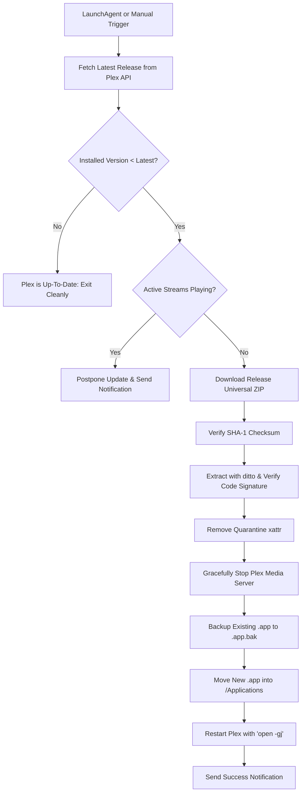

# Plex Media Server macOS Auto-Updater

A lightweight, robust, native macOS background service that automatically checks for, downloads, verifies, installs, and restarts [Plex Media Server](https://www.plex.tv/) whenever a new update is released.

---

## ✨ Features

- **Automated macOS Background Service (`launchd`)**: Runs automatically at your preferred schedule (e.g., every 6 hours or daily at 4:00 AM) using a native macOS LaunchAgent.
- **Smart Active Stream Protection**: Checks whether someone is currently watching or streaming media. If active playback sessions are detected, the update is automatically deferred to prevent disrupting viewers.
- **Official Plex API & Checksum Verification**: Fetches releases directly from Plex's official manifest (`plex.tv/api/downloads/5.json`) and verifies the SHA-1 checksum before installing.
- **macOS Code Signature & Gatekeeper Verification**: Verifies Apple Developer ID code signatures using `/usr/bin/codesign` and clears quarantine flags (`xattr`) so updates launch seamlessly without security prompts.
- **Zero-Downtime Atomic Swapping with Rollback**: Existing installation is backed up to `.bak` prior to replacement. If anything goes wrong, the backup is restored instantly.
- **Graceful Shutdown & Focus-Free Restart**: Gracefully terminates Plex and its helper processes (`Plex Transcoder`, `Plex Tuner Service`), then relaunches in the background (`open -gj`) without stealing window focus.
- **Native macOS Notifications**: Sends Notification Center alerts when an update is installed, postponed, or if an error occurs.
- **Plex Pass & Public Channels**: Supports both public releases and early-access/beta builds for Plex Pass subscribers with auto-detected or configured tokens.
- **Zero Third-Party Dependencies**: Built entirely using Python 3's standard library and native macOS binaries (`launchctl`, `ditto`, `codesign`, `osascript`). No `pip install` required!

---

## 🚀 Quick Start

### 1. Installation

Clone or navigate to the project directory, then run the installer:

```bash
git clone https://github.com/your-username/plex-server-macos-auto-updater.git
cd plex-server-macos-auto-updater
./install.sh
```

The installer will:
1. Detect your Python 3 environment.
2. Initialize `config.json` with sensible defaults.
3. Generate and load the LaunchAgent service into `~/Library/LaunchAgents/com.plex.macos-auto-updater.plist`.

### 2. Verify Status

Check the status of your Plex Media Server and background service:

```bash
./plex_updater.py status
# or
make status
```

---

## 🛠️ CLI Reference

The updater script can be used interactively at any time:

| Command | Description |
|---|---|
| `./plex_updater.py status` | Shows Plex running state, installed version, latest release, and service status |
| `./plex_updater.py check` | Checks for available updates without applying any changes |
| `./plex_updater.py update` | Checks and applies updates if a new version is available |
| `./plex_updater.py update --dry-run` | Simulates the update process without touching any files |
| `./plex_updater.py update --force` | Forces reinstallation of current/latest version |
| `./plex_updater.py update --ignore-streams` | Installs update immediately even if streams are active |
| `./plex_updater.py rollback` | Restores previous `.bak` version of Plex Media Server |
| `./plex_updater.py service status` | Checks if LaunchAgent service is registered and active |
| `./plex_updater.py service start` | Triggers an immediate execution through launchctl |
| `./plex_updater.py service install` | Regenerates and registers LaunchAgent plist |
| `./plex_updater.py service uninstall` | Unloads and deletes LaunchAgent plist |

---

## ⚙️ Configuration (`config.json`)

Configuration is stored in `config.json` (or `~/.config/plex-auto-updater/config.json`):

```json
{
  "app_path": "/Applications/Plex Media Server.app",
  "channel": "public",
  "token": "",
  "check_active_streams": true,
  "keep_backup": true,
  "notify": true,
  "schedule": {
    "type": "interval",
    "interval_hours": 6,
    "calendar_hour": 4,
    "calendar_minute": 0
  },
  "log_file": "~/Library/Logs/PlexAutoUpdater.log"
}
```

### Configuration Options

| Option | Type | Default | Description |
|---|---|---|---|
| `app_path` | string | `/Applications/Plex Media Server.app` | Location of your Plex Media Server app bundle |
| `channel` | string | `"public"` | Release channel: `"public"` or `"plexpass"` |
| `token` | string | `""` | Plex authentication token. If blank, auto-detected from `Preferences.xml` |
| `check_active_streams` | boolean | `true` | Postpones updates if active streams/transcodes are running |
| `keep_backup` | boolean | `true` | Keeps `/Applications/Plex Media Server.app.bak` for easy rollback |
| `notify` | boolean | `true` | Sends macOS Notification Center banner notifications |
| `schedule.type` | string | `"interval"` | Scheduling mode: `"interval"` (every N hours) or `"calendar"` (fixed time) |
| `schedule.interval_hours` | number | `6` | Check frequency in hours when `type` is `"interval"` |
| `schedule.calendar_hour` | integer | `4` | 24-hour hour (0-23) when `type` is `"calendar"` (e.g. `4` = 4:00 AM) |
| `schedule.calendar_minute` | integer | `0` | Minute (0-59) when `type` is `"calendar"` |
| `log_file` | string | `~/Library/Logs/PlexAutoUpdater.log` | Destination log file path |

---

## 🔄 How It Works



1. **Check**: Queries `https://plex.tv/api/downloads/5.json` and compares with the currently installed version (`Contents/Info.plist` or `http://127.0.0.1:32400/identity`).
2. **Stream Check**: Queries `http://127.0.0.1:32400/status/sessions`. If viewers are streaming, the update safely yields.
3. **Download & Verify**: Downloads the universal macOS archive and compares SHA-1 against Plex's manifest.
4. **Extraction**: Uses `/usr/bin/ditto` to extract while preserving all macOS bundle metadata and permissions.
5. **Security Validation**: Runs `/usr/bin/codesign` to verify Apple Developer ID signatures and strips quarantine flags.
6. **Graceful Stop**: Asks Plex to quit via AppleScript (`osascript`) so SQLite databases and transcode sessions close cleanly.
7. **Atomic Replacement**: Moves existing app to `.bak` and slides new version into place.
8. **Silent Restart**: Launches Plex hidden in the background (`open -gj -a "Plex Media Server"`) and verifies server health.

---

## 🧪 Testing

Run the included automated unit test suite:

```bash
make test
# or
python3 -m unittest discover tests
```

---

## 🗑️ Uninstallation

To stop the background service and remove the LaunchAgent plist:

```bash
./uninstall.sh
# or
make uninstall
```

---

## 📄 License

MIT License. Free for personal and commercial use.
